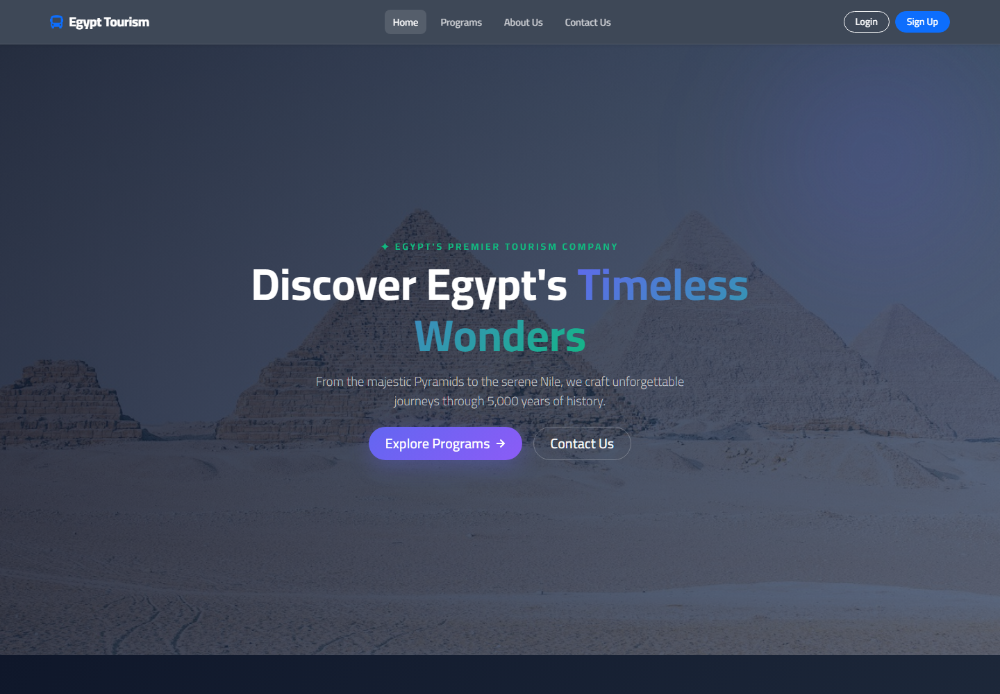
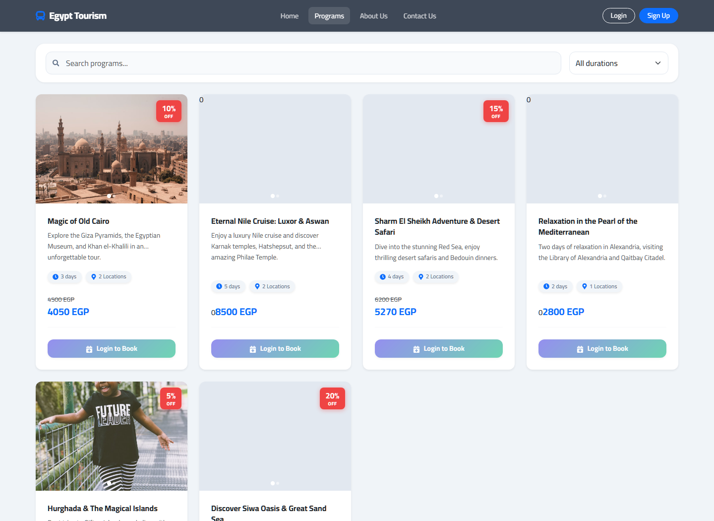

<div align="center">


# TourisMe — Luxor Tourism & Trip Booking

**Discover Egypt. Plan a smoother trip.**

A bilingual-ready tourism experience for exploring destinations and travel programs, with a customer-facing interface and an administration area.

[](https://react.dev/)
[](https://vite.dev/)
[](https://laravel.com/)
[](https://www.php.net/)
[](#license)

[Explore the repository](https://github.com/mahmoudahmed558/Luxor-Tourism-site-with-admin-panel) · [Report a bug](https://github.com/mahmoudahmed558/Luxor-Tourism-site-with-admin-panel/issues)

</div>

> **بالعربية:** منصة سياحية لاستكشاف الرحلات والبرامج السياحية وإدارة الحجوزات. يحتوي المشروع على واجهة React تجريبية مستقلة، بالإضافة إلى تطبيق Laravel منفصل. راجع قسم [هيكل المشروع](#project-structure) لمعرفة طريقة تشغيل كل جزء.

## At a glance

- Browse travel programs and trips, view destination details, and explore travel options.
- Customer pages for registration, sign-in, contact, profile, and bookings.
- Admin-area screens for managing programs, bookings, users, and images.
- Responsive React interface with reusable components, maps/location utilities, and motion effects.
- A separate Laravel application with database-backed models, migrations, authentication, and admin routes.

## Screenshots

| Discover trips | Programs |
| --- | --- |
|  |  |

Screenshots are captured from the running frontend. The standalone frontend currently uses mock/local browser data; the Laravel application is a separate implementation and is not automatically connected to it.

## Project structure

```text
.
├── frontend/   # React 18 + Vite SPA and its mock/local data services
└── backend/    # Laravel 12 + Inertia/React application
```

The two directories are independently runnable applications, not a single combined dev server:

- **`frontend/`** is a standalone SPA. Its current authentication and data services are client-side demonstrations using local/mock data.
- **`backend/`** is a Laravel application with its own React/Inertia pages, database models, migrations, and server-side routes.

Do not treat the frontend's mock authentication as production authentication or assume its data is persisted by the Laravel backend.

## Requirements

Install the tools needed for the app you want to run:

| App | Requirements |
| --- | --- |
| Standalone frontend | Node.js 18+ and npm |
| Laravel backend | PHP 8.2+, Composer, Node.js 18+ and npm |

## Quick start: standalone frontend

```bash
cd frontend
npm ci
npm run dev
```

Open the local URL printed by Vite (normally `http://localhost:5173`).

Production build and lint:

```bash
npm run build
npm run lint
```

The production build succeeds. The existing frontend currently reports ESLint errors and warnings, so lint cleanup remains outstanding.

## Quick start: Laravel backend

```bash
cd backend
composer install
copy .env.example .env
php artisan key:generate
php artisan migrate --seed
npm ci
npm run build
php artisan storage:link
php artisan serve
```

Open `http://127.0.0.1:8000`. Configure the database, mail, and other services in `backend/.env` for your environment. The example environment is intended for local development; never commit your real `.env` file or production credentials.

For frontend asset hot reload while developing the Laravel app, run the Vite dev server in a second terminal:

```bash
cd backend
npm run dev
```

Run the backend tests with:

```bash
cd backend
php artisan test
```

## Main screens

| Area | Screens |
| --- | --- |
| Public | Home, programs, trip listing, about, contact, booking confirmation |
| Customer | Register, sign in, profile, bookings |
| Administration | Dashboard, programs, bookings, users, image uploads |

The actual routes and available screens may differ slightly between the standalone React app and the Laravel/Inertia app.

## Security notes

- Never commit `.env` files, API keys, passwords, database dumps, or uploaded customer data.
- The standalone frontend contains demonstration-only client-side auth/data behavior. Client-side checks are not a security boundary.
- Use server-side authorization and properly configured secrets before deploying or connecting real customer data.
- The Laravel seeder creates demo accounts with fixed development passwords. Change them before exposing a seeded instance and never use the demo credentials in production.

## Contributing

Bug reports and pull requests are welcome. Please include the affected app (`frontend` or `backend`), steps to reproduce, and any relevant test/build output.

## License

No project-level license has been specified yet. Until a license is added, all rights are reserved; the badges above describe the frameworks used and do not grant rights to this project's code or assets.
